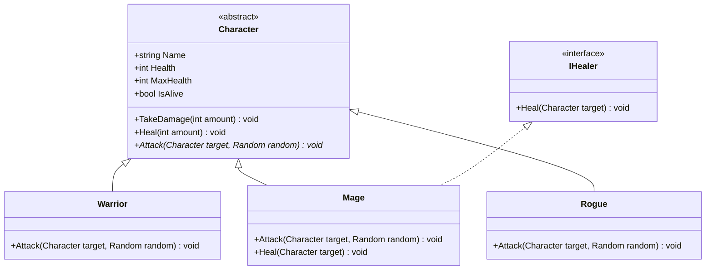

# Console RPG Arena

A turn-based console RPG built with C# and .NET.

## Features

- Two parties with multiple characters
- Three character classes: Warrior, Mage, and Rogue
- Random damage values
- Healing ability through the `IHealer` interface
- Turn-based player and enemy actions
- Target selection and input validation
- Status overview
- Victory, defeat, and quit conditions

## Run the project

```bash
dotnet run
```

## How to play

During a character's turn, select one of the available actions:

1. Attack
2. Use ability (healers only)
3. Show status
4. Quit

Choose targets by entering the displayed target number.

## Project structure

- `Program.cs` — game loop, menus, target selection, and battle flow
- `Models/Character.cs` — abstract base class
- `Models/Warrior.cs` — warrior implementation
- `Models/Mage.cs` — mage and healer implementation
- `Models/Rogue.cs` — rogue implementation
- `Models/IHealer.cs` — healing interface


## UML class diagram

